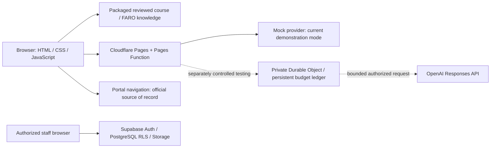

> Current owner decision: students use [browser-only MIRA](BROWSER_ONLY_MIRA.md) directly on Cloudflare. No connector, extension, pairing or local helper is required. Public answers appear in chat; personal records remain in the official portal pending approved integration. Controlled Sol access is preserved; public paid AI and portal writes remain disabled. Earlier connector setup sections are internal development history only.

> Live information update: [Read-only capability and verification record](LIVE_INFORMATION.md). Demonstrate ?What presentation materials are available?? and ?Tell me more? for live public excerpts. ?Tell me about the Capstone program? and ?How can companies engage with Capstone?? use newly allowlisted public pages. No private portal value is claimed without an active verified local connection.

> Current classroom release: see [final product polish and verification](PRODUCT_POLISH_RELEASE.md). MIRA product copy, accurate data-provider disclosure and the completed authenticated acceptance supersede dated checkpoints below. Restricted live AI remains disabled by default.

# MIRA class demonstration and handoff

Prepared November 12, 2026. MIRA means Messaging, Information & Resolution Assistant. Current preview: https://mira-9gg.pages.dev/. This guide supersedes older candidate-status paragraphs for classroom operation; historical release records remain evidence of their dates.

## Six-minute demonstration

| Time | Action | Say / verify |
|---|---|---|
| 0:00–0:40 | Open the dashboard; briefly open navigation and Profile | MIRA combines course guidance, navigation, work preparation and support. It is a pre-integration proof of concept. |
| 0:40–1:25 | Ask the embedded composer “What are acceptance criteria?” | Read the sourced answer. Open the citation only if the portal is already signed in; otherwise show the destination. A source link is not a claim of live account access. |
| 1:25–2:30 | Select CAP-1316 in Team Workspace | Point to “Snapshot, not live portal state.” Enter fictional evidence in one criterion: “Fictional demo: test output prepared for review.” Choose Check my progress and What's missing? |
| 2:30–3:20 | Choose Prepare evidence and Ask a teammate | These are mock draft recommendations. Evidence prepared does not mean submitted, verified, accepted or Done. MIRA makes no portal changes. |
| 3:20–4:05 | Prepare from selected card; inspect duplicate warning | Draft remains local. The warning uses the historical snapshot; confirm current portal state before manually posting. Never submit during the demo. |
| 4:05–4:45 | Inspect Sprint Review and Retrospective prompts | Explain unfinished work, evidence gaps, human decisions and improvement proposals. |
| 4:45–5:25 | Use floating MIRA: “Where is my grade?” | Show the honest personal-data boundary and portal shortcut. Show a sourced course answer next. |
| 5:25–6:00 | Optional signed-in Staff Queue, otherwise signed-out screen | Authorized staff may inspect fictional tickets read-only. Do not change status, notes, passwords or attachments. Close with limitations and proposed integration. |

Keep both assistant entry points on the same knowledge backend. Do not call mock drafts live OpenAI. The prior GPT-6.1 Sol result is a **recorded controlled test**, not an enabled public feature.

## Reliable offline fallback

Before class, install dependencies and build while online. In DEVELOPMENT:

```powershell
npm.cmd ci
$env:MIRA_PUBLIC_ORIGIN='https://mira-9gg.pages.dev/'
npm.cmd run package:cloudflare
npm.cmd run verify:cloudflare
npm.cmd run preview:cloudflare
```

Open http://127.0.0.1:3010/. Keep that terminal open. The packager also requires the approved Supabase URL/publishable configuration, from environment variables or the existing local configuration. Never use a privileged key. The local preview serves only verified public files and invokes the production Function's mock handler with an empty environment. It cannot activate the real provider even if the shell has live-provider variables.

Once built, course retrieval, workspace drafts and slides work without Wi-Fi. Supabase sign-in and external citations still require a network. If authentication fails, show the signed-out screen and explain the access boundary. If Cloudflare fails, use this local preview. If all servers fail, open the self-contained HTML slides or PDF in dist/presentation. Screenshots are labeled recorded evidence. Do not improvise a paid AI call or loosen security during class.

## Architecture and deployment



Node.js runs development, packaging and tests. Supabase uses PostgreSQL and SQL policies; browser and Cloudflare application code are JavaScript. Cloudflare Pages hosts the public bundle; Pages Functions enforce AI boundaries; a separate private Worker hosts the persistent Durable Object ledger. Ocelot remains unchanged as rollback. The optional local connector is session-scoped read-only development tooling, not a hosted automatic portal connection.

Publish only reviewed source to preview/mira-cloudflare. Cloudflare builds DEVELOPMENT with npm ci and npm run package:cloudflare, output dist/cloudflare/MIRA. Verify the full deployed commit, immutable URL, all 32 downloadable hashes, the configuration-only _headers entry and recovery no-store. Never upload DEVELOPMENT or runtime data. Main and Ocelot require separate migration approval.

## Feature inventory and boundaries

| Capability | Current demonstration behavior |
|---|---|
| Course / FARO questions | Reviewed answers, excerpts, citations, clarifying choices and honest missing evidence |
| Embedded + floating MIRA | Same retrieval; no public paid inference |
| Team Workspace | Historical Sprint 5 snapshot, card criteria, seven draft-only actions |
| Evidence assessment | Draft evidence count; does not assert verification or acceptance |
| Stand-up / ceremonies | Draft fields, duplicate warning, Sprint Review and Retro prompts |
| Personal information | Portal navigation or explicitly shared temporary context; no automatic hosted private reads |
| Staff Queue | Supabase Auth plus active staff binding, protected tickets and attachments; existing owner session, fictional ticket read/download and logout verified November 12-13 |
| Recovery | Signed-out UI and no-store page; no reset email in this acceptance run |
| AI gateway | Mock by default; four live scenarios verified through five controlled requests, persistent financial controls preserved |

## Student and teammate quick start

For hosted testing, open the preview without installing anything. Use fictional text. Ask a course question and inspect its source. For personal results, open the official portal. Use workspace assistance to prepare drafts, then obtain human verification and approval through the official workflow.

For source work, clone afeliz305/Capstone-AI, select preview/mira-cloudflare and open DEVELOPMENT in VS Code. Run npm.cmd ci, npm.cmd test and npm.cmd start; use the URL printed by the server. Do not open index.html directly or use a static server for the Node transport. See TEAM_SETUP_GUIDE.md for detailed troubleshooting and alternative modes.

Build environment names (values deliberately omitted): MIRA_PUBLIC_ORIGIN, MIRA_SUPABASE_URL, MIRA_SUPABASE_PUBLISHABLE_KEY. Current runtime mode: MIRA_AI_PROVIDER=mock, MIRA_AI_LIVE_ENABLED=false. Server-only encrypted secret name: OPENAI_API_KEY. A key is neither required nor requested for this demo. See AI_CONTROLLED_BUDGET.md for controlled-test/operator configuration; do not copy credentials into assets or guides.

## Operator runbook

Before class: verify site and local fallback, rehearse the script, keep PDF available, use a clean browser window, confirm no real student data on screen, and sign into Staff Queue personally only if that optional segment is desired. No password or token belongs in slides, screenshots or logs.

Default classroom mode is deterministic/mock with the persistent kill switch active. For the separately approved restricted live demonstration, use only the secure start/stop workflow and current capacity/pricing checks in INTEGRATED_AI_DEMO.md. Last verified ledger: $0.029625 spent, $0 reserved, $24.970375 available. It limits MIRA-controlled usage, not unrelated spending in the classmate's API project. This polish task makes no paid requests.

After class: sign out, clear fictional drafts, close the local server when finished. Do not delete shared tickets without separate approval. Preserve unresolved reservations if a future authorized provider test has an uncertain outcome. Use the documented operator-only audited procedure, never manual ledger edits.

## Limitations and future work

- Current hosted portal snapshot is historical. Automatic private dashboard access and portal-native integration require portal-owner-approved identity, read scopes and adapters.
- Fresh email-code login may lose the requested destination; use the shortcut again after login.
- Public AI remains deterministic and workspace assistance mock. The approved restricted live demonstration supports only four reviewed prompts with expiring tester access and all financial/privacy gates.
- Existing owner-session Staff Queue access, fictional ticket read/download, requester-preview filtering and logout passed. Sign in personally before class; a new password login was not tested. See AUTHENTICATED_WEBSITE_AUDIT.md.
- Native Chrome 200% zoom exposed a short-height conversation defect; the layout repair and minimum answer-area regression passed locally. Recheck on the classroom display.
- Optional PHP runtime parity is not part of this Cloudflare release's live verification.
- Team roster: Anthony Feliz, Christopher Hernandez, Michael Alvarez, Romelin Charnel and Zavier Richardson, based on the approved staff roster. Individual contributions and presenter assignments remain unverified; confirm them with the team before assigning credit. Raul is not an active team member in this record.

Future work: portal-native integration, approved current-context synchronization, broader independently reviewed knowledge coverage, accessibility testing with assistive technology, and bounded AI evaluation after explicit authorization. No invented adoption, performance or instructor-approval claims are used.

## Presentation checklist

- [ ] Rehearse the six-minute script and assign presenters using confirmed contributions.
- [ ] Open hosted site and prebuilt local fallback before class.
- [ ] Open slides/PDF and confirm display scaling.
- [ ] Keep historical/mock/recorded labels visible.
- [ ] Optional: owner signs in, reads only fictional tickets, verifies attachment access, signs out; record result separately.
- [ ] Do not send recovery email, post stand-ups, edit portal cards or activate paid AI.
- [ ] Close with the proposed integration phase, not a claim of official FIU deployment.

Suggested closing: “The pre-integration proof of concept supports grounded course guidance, navigation, draft preparation and a protected support workflow. No professor-portal modification was required. Automatic personal-dashboard access remains a proposed integration phase.”


## Integrated AI classroom checkpoint

See [INTEGRATED_AI_DEMO.md](INTEGRATED_AI_DEMO.md) for the two-minute sourced conversation demonstration, verified follow-ups, timeout/citation repairs, historical Sol acceptance and exact restricted activation/shutdown gates. Public chat remains deterministic, workspace AI is mock, and no new paid request or financial recovery is authorized by this update.


## Restricted integrated classroom session - November 13, 2026

An expiring operator-controlled browser session supports four reviewed public-course questions, including a Done/evidence follow-up, through the shared embedded/floating controller. Default public chat stays deterministic; workspace AI stays mock. The persistent $1 integration campaign ceiling is additional to the $25 lifetime ledger and cannot reset on session restart. See [Integrated AI demo](INTEGRATED_AI_DEMO.md) for start/stop commands, evidence and the six-minute script. Earlier fixed-fixture-only activation instructions are historical and superseded by this session workflow. Supabase and portal integration are unchanged.


## Final authenticated classroom gate ? November 13, 2026

Release: `6160dee0841889a0f88b09e2c6968db5dbe2413a`, https://mira-9gg.pages.dev/. **PASS: the previously outstanding authenticated Staff Queue gate is closed for the approved restricted classroom demonstration.** This does not expand the four-prompt live-AI scope or authorize public paid AI.

- Existing authorized Chrome session loaded the queue; browser refresh retained access and the eight-record count. Only clearly fictional CAP-1002 was opened for detail inspection.
- CAP-1002 retained Attendance, In review, Anthony Feliz assignment, two requester-visible comments and the internal staff note. No Save control was used.
- The staff-only requester preview displayed both public comments and omitted the internal note. It is a filtered staff preview, not an independently authenticated requester portal or a delivered message.
- Existing TXT attachment downloaded successfully: 140 bytes; SHA-256 `9a75cded1915fb95d002fdf32ddf4a382fdecac91461dda8b9114e99dc228bd1`, matching the previous local acceptance download. No attachment changed.
- Anonymous requests to staff session, ticket list, CAP-1002 detail, requester preview, ticket table and attachment metadata table all returned HTTP 401. No private response bodies were retained.
- Profile showed the verified staff identity; Settings contained Change password. Profile ? Sign out cleared the private queue and profile; refresh remained signed out. Remember me remained unchecked and the password field was empty.
- Current hosted integrity recheck: 32/32 downloadable assets matched the approved manifest; recovery no-store, protected-path 404, mock provider and private-context rejection passed.
- No new defect reproduced. No application code, deployment, ticket, user, password, recovery email, database configuration or portal record changed. No paid OpenAI calls were made. Only the authorized session was signed out and the harmless attachment was downloaded.

The prior write/persistence/concurrency and live-AI acceptance evidence remains historical; this focused check did not repeat writes, force session expiry, inspect tokens or prove immediate revocation of a previously issued JWT. Presenter must sign in personally again before the staff demonstration. Live AI remains disabled by default and portal submissions remain disabled.

## Current information demonstration

1. Show the public source title, checked time (Eastern with EST/EDT), citation and no-AI disclosure. Publication time is unknown unless the source supplies Last-Modified.
2. Ask Tell me more: MIRA re-fetches the same approved source and shows additional excerpts. This source-only context expires after five minutes; it is not persistent storage.
3. Explain that public live retrieval needs the network. The offline preview uses labeled reviewed knowledge fallback.
4. The local helper terminal and extension must be personally paired before personal testing. Use only the authorized owner account. Do not project, screenshot or record actual grades, identifiers, messages or private team records. If pairing or identity verification is unavailable, show the boundary rather than a historical snapshot as live. Grade remains disabled even after pairing.
5. The current source wrappers support own cards, team, rhythm, meetings, deadlines and standing within existing extraction limits; team-wide completion and official approval are not inferred. No portal submissions or new AI activation during this demo.
