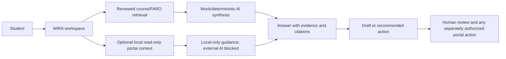

# MIRA unified team workspace

Status: expanded local owner-review candidate, November 12, 2026. No portal, Supabase, Ocelot, Git, or external AI change was made.

## Unified architecture

In plain language: the student asks MIRA; MIRA retrieves reviewed sources and, only in the local connector, the user's freshly authorized portal context; it then returns sourced guidance or a draft. Official verification, acceptance, status changes, and submission stay with the human and portal.

## What is implemented

The existing MIRA dashboard now contains one integrated Sprint Workspace. It is not a second application. Students can switch between team and individual views, filter Sprint 5 cards, select a permitted card, review acceptance criteria and dependencies, draft criterion evidence, create actionable steps, prepare a teammate handoff, draft the three portal stand-up fields, and prepare Sprint Review or Retrospective notes.

The workspace deliberately uses the verified November 12 portal audit as a **snapshot**. It never claims the snapshot is current. The live portal board remains authoritative for ownership, status, evidence, submission, verification, and acceptance.

Every workspace object has a source/state boundary. The local connector may refresh an explicitly requested current-context answer, but it does not rewrite the audited snapshot or public index:

| Information | Source | State shown | Permission |
| --- | --- | --- | --- |
| Sprint/card/owner/status/dependency | November 12 portal audit | Snapshot | Read-only |
| Existing evidence counts | November 12 portal audit | Verified or unavailable | Read-only |
| Criterion evidence typed in MIRA | Student | Draft | Browser page only |
| Stand-up text | MIRA/student | Draft, not submitted | Browser page only |
| Review/retro text | MIRA/student | Draft, not submitted | Browser page only |
| Portal submission/status movement | Capstone portal | Unavailable in MIRA | No write permission |
| Local connector result | User-selected current portal section | Temporary, expires | Read-only; external AI ineligible |

Cards distinguish work completed, evidence prepared, evidence submitted, verified, accepted, and done. Missing values remain unknown rather than becoming false or zero. Review readiness is only a recommendation and never an approval.

## Card preparation

Selecting a card supports seven explicit assistance actions without changing the portal:

1. Read the audited details and acceptance criteria.
2. Ask the existing grounded MIRA assistant to explain the requirements.
3. Break work into a confirmation, implementation, evidence, verification, and authorized-portal sequence.
4. Draft evidence for each criterion.
5. Count which criteria have a draft evidence statement; this never marks them verified or accepted.
6. Draft a teammate handoff with owner, snapshot status, dependency, and requested review.
7. Check whether the supplied evidence appears ready for human review, without approving it.

Each result cites only the reviewed source supplied with the card. Portal-derived context is marked ineligible for external processing, and the browser gateway short-circuits without a network call. See [AI and portal-context testing](MIRA_AI_PORTAL_TESTING.md).

## Stand-up Assistant

The draft uses the portal's exact fields:

- What I did
- What I will do
- What's blocking me

The last verified snapshot shows 2 of 2 weekly submissions and 4 of 4 Sprint 5 submissions. Therefore every generated draft displays a duplicate warning and requires the student to check the current portal. A possible dependency is not called a blocker until the student confirms it. MIRA has no Post/Submit action.

## Review and retrospective

Sprint Review preparation asks what was demonstrated, which criteria have evidence, what remains unfinished/human-decided, and who will verify it. Retrospective preparation uses Keep, Change, and one specific team experiment. Both remain editable local drafts.

## Future authorized submission design

Any future write integration must follow this sequence:

`Draft -> Human review -> Explicit approval -> Authorized portal submission -> Read-back confirmation`

Before implementation, the portal owner must provide a documented same-origin write API or an approved authenticated submission contract, field-level authorization, CSRF/replay protection, idempotency, conflict/version handling, audit records, and a read-back receipt. DOM automation, copied session cookies, or browser scraping is not an authorized submission API. No live-write experiment was performed.
